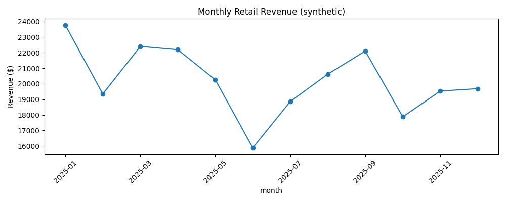

# Retail Revenue & Customer Intelligence
**Target:** Business Analyst / BI Intern | **Stack:** SQL (SQLite), Python, pandas, Excel, Power BI

## Business question
Which product categories, regions, and customers drive revenue, and where should a retail business focus attention?

## How to run
```bash
pip install -r requirements.txt
python analysis.py
```
Outputs: `figures/monthly_revenue.png`, `outputs/category_summary.csv`, `outputs/retail.db`. Open `excel_report.xlsx` for the reporting workbook.

## Power BI layout
Cards: Total Revenue, Orders, Average Order Value. Visuals: Monthly Revenue line, Category Revenue bars, Region Revenue bars. Slicers: Date and Region.

## Key definitions
Revenue = units × unit price × (1 − discount). Order ID is unique in the sample. Data are **synthetic**, not a real retailer's transactions.

## Sales Performance Visualization


